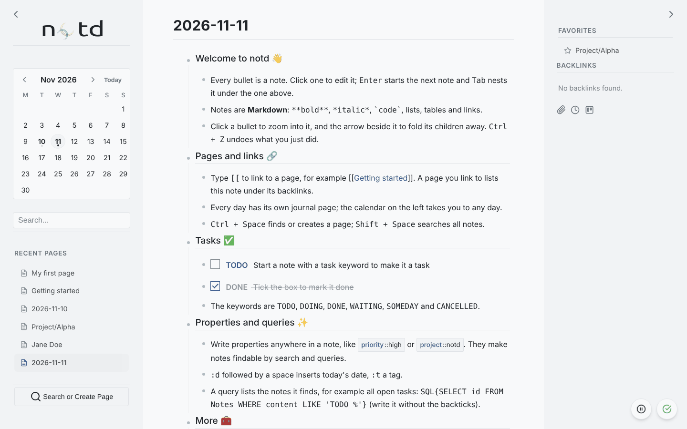

# notd

A small outliner for notes, journals and tasks, inspired by [Logseq](https://logseq.com/). Plain PHP, plain JavaScript and one SQLite file that you own.

**Documentation: <https://andjar.github.io/notd/>**



## What it does

- **Outline editing** in Markdown: nest, collapse, drag and reorder notes
- **Journal**: a page for every day
- **Links and backlinks**: `[[Page Name]]`
- **Tasks**: `TODO`, `DOING`, `DONE`, `WAITING`, ... with checkboxes and a kanban board
- **Properties**: `{key::value}` metadata that search, queries and extensions can use
- **Queries and transclusion**: `SQL{...}` lists notes, `!{{note-id}}` embeds one
- **Attachments, templates, namespaces, favorites, per-page encryption**
- **Extensions**: kanban board, pomodoro timer, attachment dashboard, zen editor, math notepad, Excalidraw, RSS
- **HTTP API** for everything the interface can do

## Built to last

- **No build step, no package manager, no framework.** The repository is the application.
- **Nothing is loaded from the internet.** The few libraries it uses are in `assets/libs/`.
- **Works offline.** Edits made while the server is unreachable are kept in the browser and sent later.
- **Your data is plain text** in a documented SQLite schema (`db/schema.sql`).

## Run it

Requires PHP 7.4+ with `pdo_sqlite` and `mbstring`.

```bash
git clone https://github.com/andjar/notd.git
cd notd
php -S localhost:8000 router.php
```

Open <http://localhost:8000>. The database is created on first use.

notd has no login: it is made for one person on their own machine. If you host it where others can reach it, put it behind HTTP authentication. It can also be packaged as a desktop app with [phpdesktop](https://github.com/cztomczak/phpdesktop).

## Configure it

Defaults are in `config.php`. Put your own settings in `config.local.php` (ignored by git; see `config.local.example.php`):

```php
<?php
define('ACTIVE_THEME', 'darkly');
define('ACTIVE_EXTENSIONS', ['kanban_board', 'pomodoro_timer', 'zen']);
```

## Upgrade

Replace the code and keep `db/`, `uploads/` and `config.local.php`. If the database is older than the code, notd says which migration to run. Coming from a version before November 2026:

```bash
php db/migrate_v3.php    # keeps a backup next to the database
```

See the [changelog](https://andjar.github.io/notd/docs/overview/changelog/).

## Develop

The [development guide](https://andjar.github.io/notd/docs/development/) explains the architecture and conventions. Tests need no build step:

```bash
node tests/js/model.test.mjs          # outline model and outbox
node tests/js/ordering_parity.mjs     # JavaScript and PHP sort keys agree

# with a server on a throw-away database:
NOTD_DB_PATH=/tmp/notd-test.sqlite PHP_CLI_SERVER_WORKERS=4 php -S 127.0.0.1:8765 tests/browser/router.php
node tests/js/ops_api.test.mjs        # write endpoint
python3 tests/browser/outline_test.py # browser tests (pip install playwright && playwright install chromium)
python3 tests/browser/features_test.py
```

Contributions are welcome: open an issue or a pull request.

## License

GPL-3.0-or-later; the full text is in [LICENSE](LICENSE). The libraries in `assets/libs` and `extensions` keep their own licenses.
