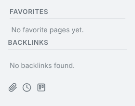
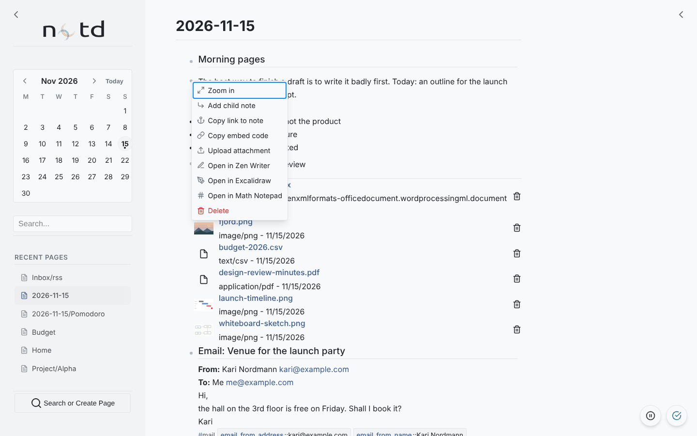

Extensions are small apps in the `extensions/` folder. They work on your notes through the same [API]() as the interface, so whatever they do ends up as ordinary notes and properties: there is nothing extra to keep in sync, and turning an extension off loses nothing.

## The default extensions

A new installation has three extensions turned on. Their icons are in the right sidebar, below the backlinks (open the sidebar with the arrow in the top right corner):



| Extension | What it does |
|---|---|
| [Kanban board]() | Every task in your notes as a card, one column per state. Drag a card to change its state. |
| [Pomodoro timer]() | A work/break timer that logs each finished session as a note. |
| [Attachment dashboard]() | Every uploaded file in one searchable, sortable list. |

## More extensions included

These come with notd but are off until you turn them on.

| Extension | What it does | Opened from |
|---|---|---|
| [Zen writer]() | A distraction-free, full-screen editor for one note. | Note menu |
| [Math notepad]() | Calculations line by line, with variables; results beside each line. | Note menu |
| [Excalidraw]() | Hand-drawn diagrams, saved to a note as attachments. Needs an internet connection. | Note menu, sidebar |
| [RSS handler]() | A script that adds new feed items as notes. | Command line, scheduler |
| [Mail handler]() | A script that turns an e-mail, with its attachments, into a note on today's journal page. | Command line, mail server |

The note editors appear in the menu you get by right-clicking a note's bullet, once they are turned on:



[Espanso](), a text expander, can send copied text to today's journal page with a small configuration file that comes with notd.

## Turning extensions on and off

`ACTIVE_EXTENSIONS` lists the extensions that are on, by folder name. The default is:

```php
define('ACTIVE_EXTENSIONS', ['attachment_dashboard', 'pomodoro_timer', 'kanban_board']);
```

To change it, put your own list in `config.local.php` (next to `config.php`; see `config.local.example.php`). For example, to also have the Zen writer and the math notepad:

```php
<?php
define('ACTIVE_EXTENSIONS', ['attachment_dashboard', 'pomodoro_timer', 'kanban_board', 'zen', 'math_notepad']);
```

Reload notd after changing it. Extensions with a page of their own (`index.php`) get a sidebar icon; the Zen writer, math notepad and Excalidraw also appear in the note menu. The note editors are not offered on encrypted pages, because they would see the note's text unencrypted.

The RSS and mail handlers are scripts you run yourself, so they work whether or not they are in the list.

Each extension keeps its settings in `config.json` in its own folder. Those files are part of notd and are replaced when you update it, so keep a copy of any you change.

## Writing your own

An extension is a folder with a `config.json` and a page; see [Writing an extension]().
