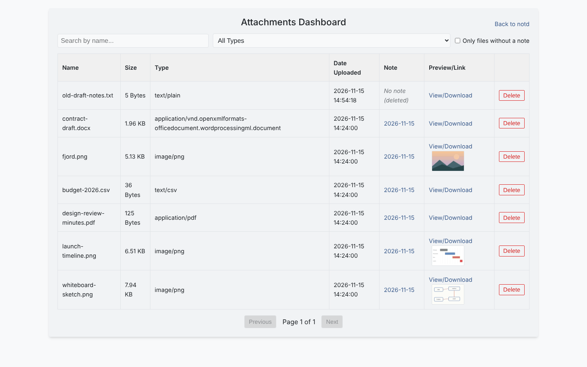

Files you attach to notes (paste or drop them onto a note, or use **Upload attachment** in the note menu) are shown below the note they belong to. The attachment dashboard lists all of them in one place.

It is on by default; open it with the paperclip icon in the right sidebar.

- **Search** by file name with the field at the top; **filter** by file type with the menu next to it.
- **Sort** by clicking a column heading (name, size, type, date uploaded); click again to reverse.
- **Open** a file with **View/Download**. Images also show a small preview.

Files are listed newest first, a page at a time; use **Previous** and **Next** at the bottom.

To delete a file, use the trash icon next to it under its note. Deleting a page deletes the files of its notes as well. Deleting a single note keeps its files: they stay in the dashboard, so nothing you uploaded disappears by accident.

Files are stored in `uploads/` (or the folder set with `UPLOADS_DIR`), sorted into year and month folders. Which file types are accepted, and the 10 MB limit, are described under [Attachments]().
