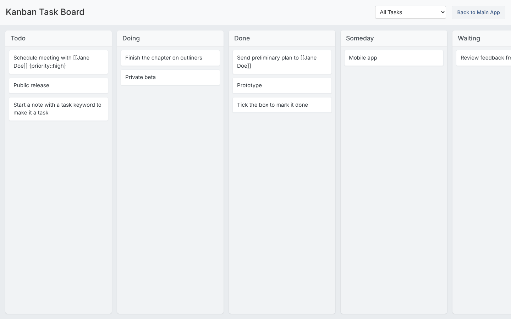

The kanban board shows every [task]() in your notes as a card, in one column per task state. Dragging a card to another column rewrites the keyword at the start of the note (for example `TODO` to `DOING`), exactly as if you had edited the note.

Cards come from notes, so there is nothing to keep in sync: create a task anywhere and it is on the board.

## Columns

There is one column per entry in the `TASK_STATES` setting, in that order (by default `TODO`, `DOING`, `DONE`, `SOMEDAY`, `WAITING`, `CANCELLED`).

## Boards

A board is a saved filter. Boards are defined in `extensions/kanban_board/config.json` and chosen from the menu at the top of the board:

```json
{
  "featherIcon": "trello",
  "boards": [
    { "id": "all_tasks",    "label": "All Tasks",    "filters": [] },
    { "id": "work_tasks",   "label": "Work Tasks",   "filters": [ { "name": "type", "value": "work" } ] },
    { "id": "urgent_tasks", "label": "Urgent Tasks", "filters": [ { "name": "priority", "value": "high" } ] }
  ]
}
```

| Field | Meaning |
|---|---|
| `id` | Unique identifier of the board. |
| `label` | Name shown in the menu. |
| `filters` | Properties a task must have to appear. A task must match every filter; an empty list shows all tasks. |

With the configuration above, this task appears on "All Tasks", "Work Tasks" and "Urgent Tasks":

```markdown
TODO Prepare the quarterly report {type::work} {priority::high}
```
