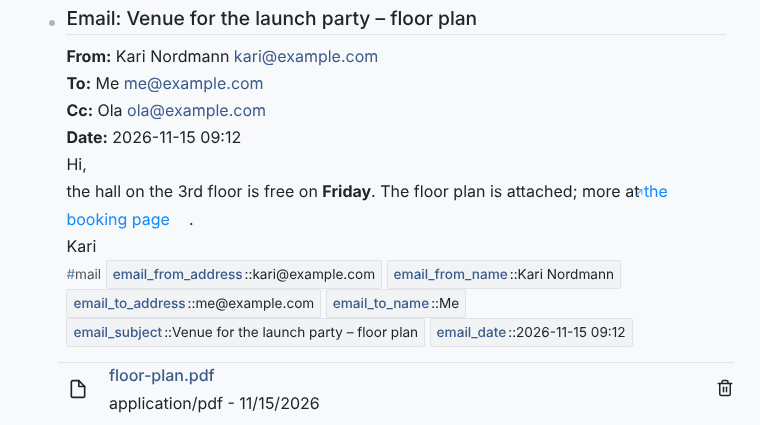

The mail handler reads one e-mail message (in the raw `.eml` format that mail programs and servers use) and adds it as a note to today's journal page, with its attachments attached to the note.

It does not fetch mail itself. Something else hands it the message: a mail server rule that pipes incoming mail to a program, a mail client's "pipe to command" action, or you, with a saved `.eml` file.

## Using it

Set notd's address in `extensions/mail_handler/config.json`:

```json
{
  "featherIcon": "mail",
  "api_url": "http://localhost:8000/api"
}
```

and give the script a message on its standard input:

```bash
php extensions/mail_handler/mail_handler.php < message.eml
```

The address can also be given as an argument, which wins over the configuration file:

```bash
php extensions/mail_handler/mail_handler.php http://localhost:8000/api < message.eml
```

With Postfix, for example, an alias that pipes a dedicated address to the script sends everything mailed there into notd:

```text
notes: "|php /path/to/notd/extensions/mail_handler/mail_handler.php"
```

The script answers with the exit status a mail server expects, so nothing is lost when notd is down:

| Status | Meaning |
|---|---|
| `0` | Added, or already in notd |
| `75` | notd could not be reached or was busy; the mail server keeps the message and tries again later |
| `65` | The input is not an e-mail message |
| `1` | notd refused the note |

A message that was added before (same `Message-ID`) is not added again, so delivering it twice is harmless.

## What the note looks like

The subject becomes a heading ("Email: ..."), followed by the sender, the recipients, `Cc` and the date, then the text of the message. The note gets `{tag::mail}` and properties for the sender, the first recipient, the subject and the date (`email_from_address`, `email_from_name`, `email_to_address`, `email_to_name`, `email_subject`, `email_date`), so all mail from one person is one query away.

The handler understands the e-mail formats in everyday use:

- text in any character set, `quoted-printable` or `base64`, and encoded subjects and names (`=?UTF-8?B?...?=`),
- messages with both a text and an HTML version (the text version is used) and HTML-only messages, which are turned into Markdown with their links, lists and emphasis,
- several recipients, names with commas in them, and attachment names in any language.

Attachments become attachments of the note, if notd accepts their type and size (see [Attachments]()); one that is refused is reported and the rest of the message is still added.
