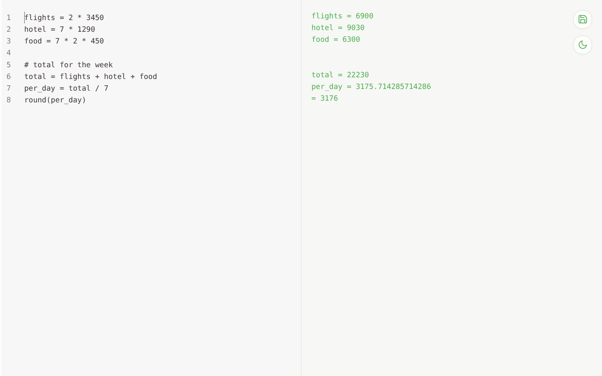

The math notepad turns a note into a small calculation sheet. Write one calculation per line on the left; the result of every line appears on the right as you type. Saving keeps the calculation in the note, so it is there to rework later.

## Turning it on

Add `math_notepad` to `ACTIVE_EXTENSIONS` in `config.local.php` (see [Turning extensions on and off]()). It then appears in the note menu.

## Using it

1. Right-click a note's bullet and choose **Open in Math Notepad**. The note opens in a new tab.
2. Write calculations, one per line.
3. Save with `Ctrl + S` (`Cmd + S` on a Mac) or the save button in the top right corner.

What a line can contain:

| Write | Result |
|---|---|
| `2 * 3450` | `= 6900` |
| `hotel = 7 * 1290` | `hotel = 9030`; `hotel` can be used on the lines below |
| `(flights + hotel) / 2` | arithmetic with `+ - * /`, `**` for powers, and parentheses |
| `round(per_day)`, `sqrt(2)`, `PI` | the functions and constants of JavaScript's `Math`: `round`, `floor`, `ceil`, `abs`, `sqrt`, `min`, `max`, `log`, `sin`, `PI`, `E` and the rest |
| `# total for the week` | a comment; also at the end of a line |

A line that cannot be calculated shows an error instead of a result, for example `Undefined variable: hotell`.

Saving replaces the note's text, as in the [Zen writer](): reload the notd tab to see it there. The two share their editor and their themes (`defaultLightTheme` and `defaultDarkTheme` in `extensions/math_notepad/config.json`).
