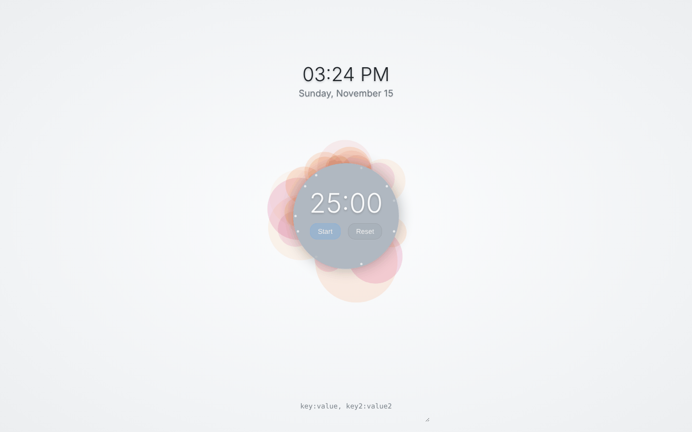
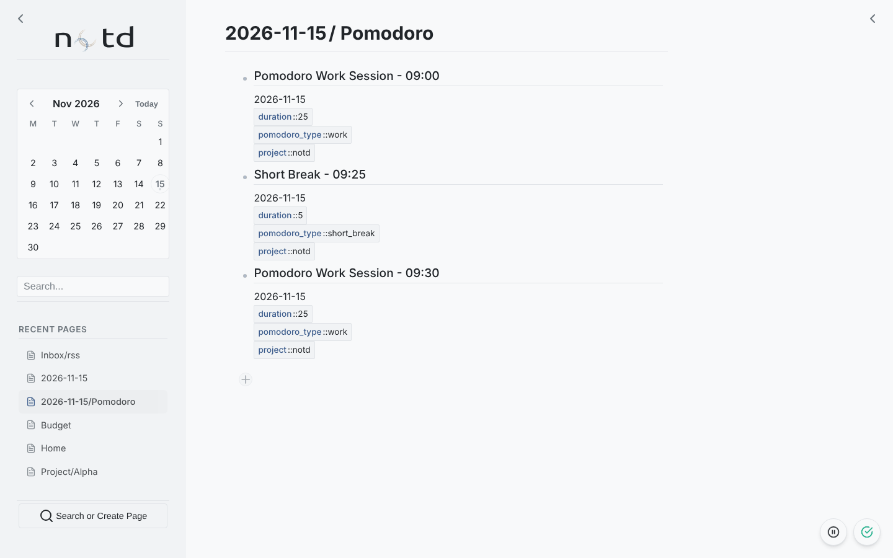

The Pomodoro timer alternates work sessions and breaks. When a session ends, it is logged as a note, so your notes show what you spent the day on and queries can add it up.

It is on by default; open it with the clock icon in the right sidebar. Leave the tab open while the timer runs.

## Using it

1. Optionally, type properties for the sessions in the field at the bottom, as `key:value, key2:value2` (for example `project:notd`). They are added to every session you log.
2. Press **Start**. The same button pauses and resumes the timer; **Reset** starts the current session over.
3. When the time is up, the session is logged and the next one in the cycle begins. With the default settings the cycle is work, short break, work, long break, and then again.

## The log

By default sessions go to a child page of the day's journal page, for example `2026-11-15/Pomodoro`:



Each note has `{duration::25}` (minutes) and `{pomodoro_type::work}` (or `short_break`, `long_break`) plus the properties you typed. That makes the log easy to query, for example every session logged for a project:

```text
SQL{SELECT N.id FROM Notes N JOIN Properties P ON N.id = P.note_id WHERE P.name = 'project' AND P.value = 'notd'}
```

## Settings

Settings are in `extensions/pomodoro_timer/config.json`:

| Key | Default | Meaning |
|---|---|---|
| `workDurationMinutes` | `25` | Length of a work session. |
| `shortBreakDurationMinutes` | `5` | Length of a short break. |
| `longBreakDurationMinutes` | `15` | Length of a long break. |
| `cycle` | `["work", "short_break", "work", "long_break"]` | The order of sessions, repeated. |
| `pageTemplate` | `<today>/Pomodoro` | Page that receives the log. `<today>` becomes the date (`2026-11-15`); `<year>`, `<month>` and `<day>` are also available. Use `<today>` alone to log on the journal page itself. |
| `noteTemplate` | see below | Text of a logged note. |

The default note template is

```text
## {noteTitle}\n\n{date}\n{duration}\n{pomodoroType}\n{customProperties}
```

where `{noteTitle}` is for example "Pomodoro Work Session - 09:00", `{date}` the date, `{duration}` and `{pomodoroType}` the two properties above, and `{customProperties}` the properties you typed, each as `{key::value}`.
