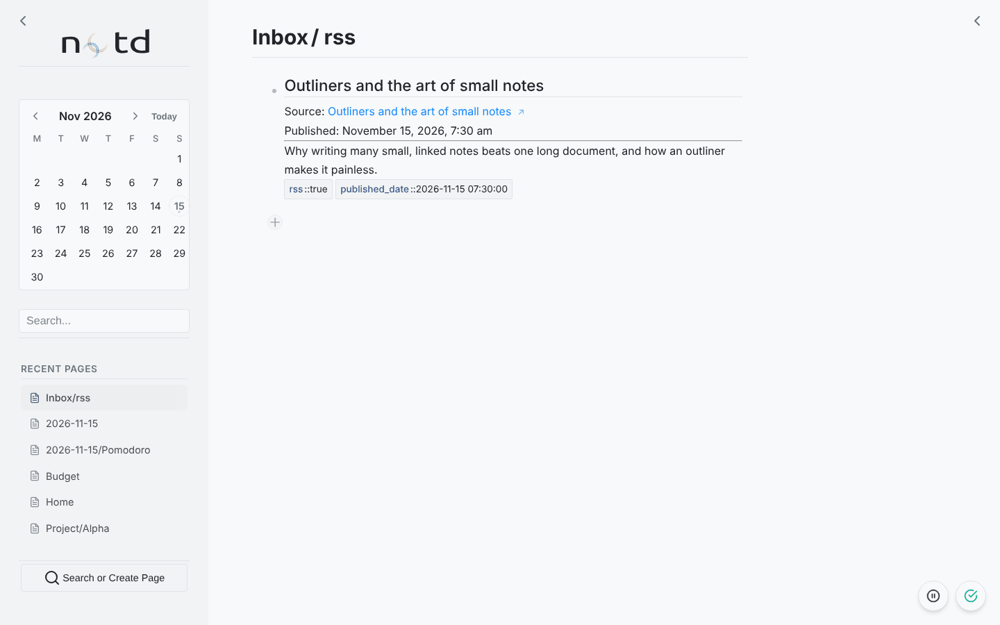

The RSS handler reads RSS and Atom feeds and adds every item it has not seen before as a note. It is a command-line script, so it runs on the machine where notd runs and can be scheduled to keep feeds up to date.

## Setting it up

List your feeds in `extensions/rss_handler/config.json`:

```json
{
  "api_url": "http://localhost:8000/api",
  "default_page_name_for_rss": "Inbox/rss",
  "feeds": [
    "https://example.com/feed.xml",
    { "url": "https://example.org/feed", "page_name": "<today>/rss" },
    { "url": "https://example.net/news.rss", "page_name": "News" }
  ]
}
```

| Key | Meaning |
|---|---|
| `api_url` | notd's address followed by `/api`. |
| `default_page_name_for_rss` | Page for feeds that do not name one. |
| `feeds` | A feed URL, or `{"url": ..., "page_name": ...}` to send that feed to its own page. `<today>` in a page name becomes the date, so `<today>/rss` collects each day's items under the journal page. |

Then run it:

```bash
php extensions/rss_handler/rss_handler.php
```

Options: `-c file` (or `--config=file`) reads another configuration file, `-a URL` (`--api-url`) overrides `api_url`, `-f URL` (`--feeds`) reads only that feed, and `-v` (`--verbose`) shows what it does.

## On a schedule

Run the same command from cron on Linux and macOS, for example every hour:

```text
0 * * * * php /path/to/notd/extensions/rss_handler/rss_handler.php
```

On Windows, create a task in Task Scheduler that runs `php.exe` with the script's path as its argument.

## What the notes look like

Each item becomes one note: the title as a heading, a link to the item, the publication date and the item's text. Its properties are `{rss::true}` and `{published_date::...}`, plus internal ones (hidden while reading) with the item's link, the feed and a fingerprint of the item.

The fingerprint is how the handler recognises items it has already added, so running it again only adds new items. If notd cannot be reached the item is skipped and counted as an error, and the next run tries again.
