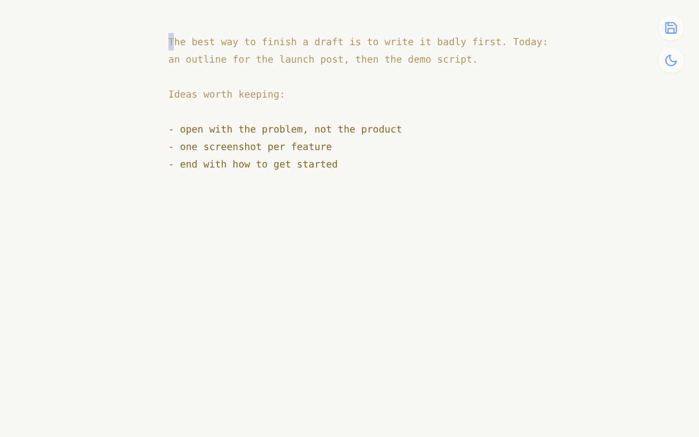

The Zen writer opens one note in a full-screen editor with nothing else on the screen: good for longer pieces of writing that would feel cramped in the outline.

## Turning it on

Add `zen` to `ACTIVE_EXTENSIONS` in `config.local.php` (see [Turning extensions on and off]()). It then appears in the note menu.

## Using it

1. Right-click a note's bullet and choose **Open in Zen Writer**. The note opens in a new tab.
2. Write. The editor highlights Markdown as you type.
3. Save with `Ctrl + S` (`Cmd + S` on a Mac) or the save button in the top right corner.

The moon/sun button switches between a light and a dark theme; the choice is remembered in the browser.

Saving replaces the note's text, the same way an edit in the outline does. Reload the notd tab to see the change there, and avoid editing the same note in both places at once: the last save wins.

Opened without a note (`extensions/zen/index.html`), the editor works as a scratch pad that is saved in the browser only.

## Themes

`defaultLightTheme` and `defaultDarkTheme` in `extensions/zen/config.json` name a theme from `extensions/zen/codemirror/themes/` (without `.css`).
