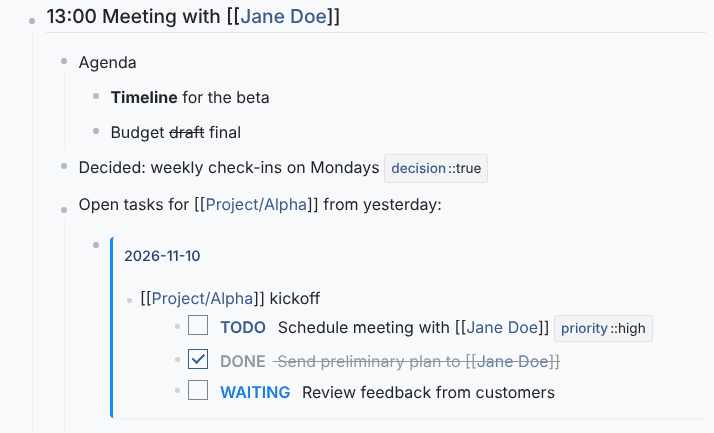
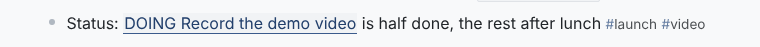

## Markdown



Notes are Markdown. A note shows the rendered text; click it to edit the source.

- `**bold**`, `*italic*`, `` `code` ``, `[text](url)`
- `#`, `##`, `###` headings
- lists, quotes, tables and fenced code blocks
- `Shift + Enter` for a line break within a note

Brackets and braces are closed automatically as you type; typing the closing one steps over it.

## Page links

```markdown
[[Page Name]]
[[Projects/Alpha]]
```

Typing `[[` suggests existing pages (arrows to choose, Enter or Tab to complete). A link to a page that does not exist yet creates it when clicked. See [Backlinks]().

### Tags

A tag is a property that links to the page of that name:

```markdown
TODO Fix the login form {tag::bug}
Planning meeting {tags::alpha, design, [[Big Topic]]}
```

`{tag::bug}` shows as **#bug** and links to the page "bug", which lists the note under its backlinks, exactly as `[[bug]]` would. `{tags::...}` takes several tags, separated by commas. Typing `:t` and a space inserts `{tag::}`.

### Aliases

A page can have other names. Add them to its page properties (gear icon next to the title):

```markdown
{alias::JS, ECMAScript}
```

`[[JS]]` then opens the page, links to an alias count as backlinks of the page, and no separate page "JS" is created. A page that already has the name itself is not affected: the alias only applies to names no page has.

### Block references

Refer to a single note inside a sentence:

```markdown
As we decided in ((0192f6a0-7c3e-7b1a-9f3e-2b1c4d5e6f70)), the launch moves to May.
```

The reference shows the first line of that note as a link to it, and always its current text:


 Right-click the bullet of the note you want to refer to and choose **Copy reference**, then paste. To show a note with its children as a block of its own, use [transclusion](#transclusion) instead.

## Properties

```markdown
{key::value}     public: shown as a pill
{key:::value}    internal: hidden when reading
{key::::value}   log: every value is kept as history
```

Properties make notes findable: by [search](), by queries (below) and by the kanban board. Quick ways to type common ones:

| Type | Becomes |
|---|---|
| `:t` + space | `{tag::}` |
| `:k` + space | `{keyword::}` |
| `:d` + space | `{date::2026-11-10}` (today) |
| `:s` + space | `{scheduled::2026-11-10}` (today; see [Scheduled and due]()) |
| `:u` + space | `{deadline::2026-11-10}` (today) |
| `:r` + space | `{timestamp::...}` (now) |

Page-level properties are edited with the gear icon next to the page title.

## Queries

`SQL{...}` in a note lists the notes that a query selects. The query must return note ids:

```markdown
SQL{SELECT id FROM Notes WHERE content LIKE 'TODO %' ORDER BY updated_at DESC}
```

To filter by property, join the property index:

```markdown
SQL{SELECT DISTINCT N.id FROM Notes N JOIN Properties P ON N.id = P.note_id WHERE P.name = 'priority' AND P.value = 'high'}
```

### Ready-made queries

Type `/query` in a note to choose one of the queries that come with notd; replace the words in capitals where there are any:

| Template | Lists |
|---|---|
| Query open tasks | every `TODO`, `DOING` and `WAITING` task, most recently changed first |
| Query open tasks on this page | the open tasks of the page you insert it on |
| Query due within a week | open notes with a `{deadline::}` in the next seven days, or overdue |
| Query done this week | tasks marked `DONE` in the last seven days |
| Query tagged | notes with a tag (replace `TAG`) |
| Query with a property | notes with a property and value (replace `project` and `VALUE`) |
| Query links to this page | notes that link to the page you insert it on |
| Query changed today | notes changed in the last 24 hours |

They are ordinary templates (`assets/template/note/Query ....md`), so you can change them or add your own.

### Writing your own

Three query shapes are accepted:

1. `SELECT id FROM Notes WHERE ...`
2. `SELECT [DISTINCT] N.id FROM Notes N JOIN Properties P ON N.id = P.note_id WHERE ...`
3. `SELECT id FROM Notes WHERE id IN (SELECT note_id FROM Properties WHERE ...)`

Queries can only read. Counting, grouping or selecting other columns is not possible unless `ADVANCED_QUERY_MODE` is turned on in the [configuration](); even then the first column must be a note id, because the result is always shown as a list of notes.

## Transclusion

Embed a note, with its children, in another place:

```markdown
!{{0192f6a0-7c3e-7b1a-9f3e-2b1c4d5e6f70}}
```

Right-click the bullet of the note you want to embed and choose **Copy embed code**, then paste. The embedded copy is read-only and always shows the current text of the original; its title links to the original. Transclusions nest up to three levels, and a note that embeds itself is shown only once.

## Attachments

Drag a file onto a note, paste an image into it, or right-click its bullet and choose **Upload attachment**. A pasted image is also inserted into the text, so it shows inline. The limit is 10 MB per file.

A note's files are listed below its text, except the ones the text already shows: an image in the text (``) or a link to a file is not listed a second time. Remove it from the text and it is listed again.

Allowed types: images (jpg, png, gif, webp), pdf, text (txt, md, csv, json), office documents (docx, xlsx, pptx, odt, ods, odp), zip, audio (mp3, m4a, ogg, wav) and video (mp4, webm). Other types, such as HTML or SVG, are refused because a browser could run code in them. The [attachment dashboard]() lists all files, with the note each belongs to.

## Templates

Type `/` in a note, then a few letters of the template name, and press Enter to insert it. Templates are plain Markdown files in `assets/template/note/` (and `assets/template/page/` for page templates). They can contain placeholders, filled in using your browser's time zone:

`{{date}}`, `{{time}}`, `{{datetime}}`, `{{year}}`, `{{month}}`, `{{day}}`, `{{weekday}}`, `{{timestamp}}`, `{{random}}`, `{{uuid}}`

The date placeholders take a PHP date format: `{{date:d.m.Y}}`. `{{page}}` and `{{page_id}}` become the name and id of the page the template is inserted on (in `{{page}}`, a `'` is doubled, so it can be used inside a query). Templates are never executed as code.

## Encryption

A page can be locked with a password: click the gear next to the page title and choose **Lock with password**.

- Notes are encrypted in the browser (AES, using the SJCL library) before they are sent, so the database only contains ciphertext for that page.
- You are asked for the password when you open the page.
- **There is no recovery.** If the password is lost, so is the content.
- Encrypted notes cannot be found by full-text search, and their properties are not indexed.
- **Remove lock** in the same dialog stores the notes readable again.

## Undo

`Ctrl + Z` undoes, `Ctrl + Shift + Z` (or `Ctrl + Y`) redoes. Right after typing, it undoes the typing, as in any text field; otherwise it undoes outline changes: new notes, splits and joins, indenting, moving, collapsing and deleting. Undo works within the current page view and goes back up to 200 steps.

## Zoom

Click a bullet (or press `Alt + Right` in a note) to show only that note and what is under it. Breadcrumbs above the outline lead back out; `Alt + Left` zooms out.

## Print and export

The gear next to the page title has:

- **Print**: prints the page, or saves it as PDF, with only the title and the outline. Collapsed notes are printed too.
- **Export**: downloads the page as a Markdown file in Logseq's layout (one `- ` bullet per note, nested with tabs).

To export or import everything, see [Moving data in and out]().
