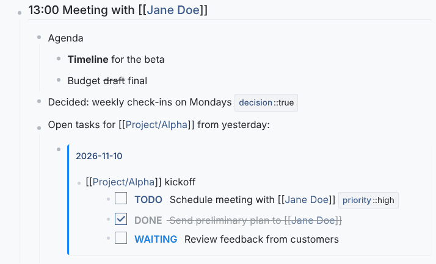

## Markdown



Notes are Markdown. A note shows the rendered text; click it to edit the source.

- `**bold**`, `*italic*`, `` `code` ``, `[text](url)`
- `#`, `##`, `###` headings
- lists, quotes, tables and fenced code blocks
- `Shift + Enter` for a line break within a note

Brackets, braces and quotes are closed automatically as you type.

## Page links

```markdown
[[Page Name]]
[[Projects/Alpha]]
```

Typing `[[` suggests existing pages. A link to a page that does not exist yet creates it when clicked. See [Backlinks]().

## Properties

```markdown
{key::value}     public: shown as a pill
{key:::value}    internal: hidden when reading
{key::::value}   log: every value is kept as history
```

Properties make notes findable: by [search](), by queries (below) and by the kanban board. Quick ways to type common ones:

| Type | Becomes |
|---|---|
| `:t` + space | `{tag::}` |
| `:k` + space | `{keyword::}` |
| `:d` + space | `{date::2026-11-10}` (today) |
| `:r` + space | `{timestamp::...}` (now) |

Page-level properties are edited with the gear icon next to the page title.

## Queries

`SQL{...}` in a note lists the notes that a query selects. The query must return note ids:

```markdown
SQL{SELECT id FROM Notes WHERE content LIKE 'TODO %' ORDER BY updated_at DESC}
```

To filter by property, join the property index:

```markdown
SQL{SELECT DISTINCT N.id FROM Notes N JOIN Properties P ON N.id = P.note_id WHERE P.name = 'priority' AND P.value = 'high'}
```

Three query shapes are accepted:

1. `SELECT id FROM Notes WHERE ...`
2. `SELECT [DISTINCT] N.id FROM Notes N JOIN Properties P ON N.id = P.note_id WHERE ...`
3. `SELECT id FROM Notes WHERE id IN (SELECT note_id FROM Properties WHERE ...)`

Queries can only read. Counting, grouping or selecting other columns is not possible unless `ADVANCED_QUERY_MODE` is turned on in the [configuration](); even then the first column must be a note id, because the result is always shown as a list of notes.

## Transclusion

Embed a note, with its children, in another place:

```markdown
!{{0192f6a0-7c3e-7b1a-9f3e-2b1c4d5e6f70}}
```

Right-click the bullet of the note you want to embed and choose **Copy transclusion link**, then paste. The embedded copy always shows the current text of the original. Transclusions nest up to three levels.

## Attachments

Drag a file onto a note, paste an image into it, or right-click its bullet and choose **Upload**. Images are shown inline; other files become download links. The limit is 10 MB per file. The Attachment Dashboard extension lists all files.

## Templates

Type `/` in a note to pick a template and insert it. Templates are files in `assets/template/note/` (and `assets/template/page/` for page templates). They can contain placeholders:

`{{date}}`, `{{time}}`, `{{datetime}}`, `{{year}}`, `{{month}}`, `{{day}}`, `{{weekday}}`, `{{timestamp}}`, `{{random}}`, `{{uuid}}`

## Encryption

A page can be encrypted with a password: click the gear next to the page title and choose **Encrypt**.

- Notes are encrypted in the browser (AES, using the SJCL library) before they are sent, so the database only contains ciphertext for that page.
- You are asked for the password when you open the page.
- **There is no recovery.** If the password is lost, so is the content.
- Encrypted notes cannot be found by full-text search, and their properties are not indexed.
