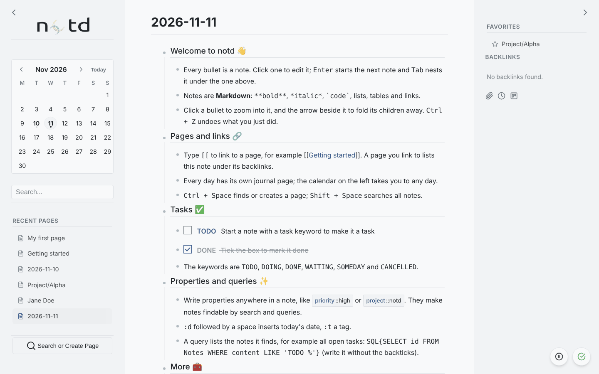
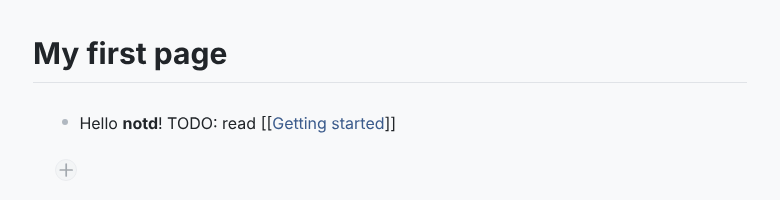

## The screen



- **Left sidebar:** calendar, search, recent pages, a button to find or create a page, and your extensions.
- **Centre:** the current page: its title and its outline of notes.
- **Right sidebar:** favorites, backlinks to this page and its child pages.

notd opens on today's journal page.

## Write



Click a bullet (or the **+** below the last note) and type. Each bullet is a note.

| Key | Action |
|---|---|
| `Enter` | New note below |
| `Shift + Enter` | Line break inside the note |
| `Tab` / `Shift + Tab` | Indent / outdent |
| `Ctrl/Cmd + Enter` | New child note |
| `Backspace` in an empty note | Delete it |

Drag a bullet to move a note together with its children. Click the arrow next to a note with children to collapse it.

Everything is saved as you type. The indicator in the bottom-right corner shows the state; if the server cannot be reached, notd keeps your edits and sends them later.

## Try the essentials

**Link to a page.** Type `[[` and pick a page, or type a new name. Clicking the link opens the page, creating it if needed.

```markdown
Kickoff notes are in [[Projects/Alpha]]
```

**Make a task.** Start a note with a task keyword. Each task is its own note.

```markdown
TODO Send the agenda
```

**Add properties.** Put `{key::value}` anywhere in a note.

```markdown
TODO Send the agenda {priority::high} {due::2026-11-14}
```

**Find things.** `Ctrl + K` jumps to the search field. `Ctrl + Space` opens a page by name. `Shift + Space` (outside a note) searches note contents.

**Mark a favorite.** Click the gear next to the page title and add `{favorite::true}` to the page properties.

## Next

- [Writing notes]() covers queries, transclusion, attachments, templates and encryption.
- [Extensions]() add a kanban board, a pomodoro timer and more.
