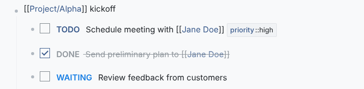
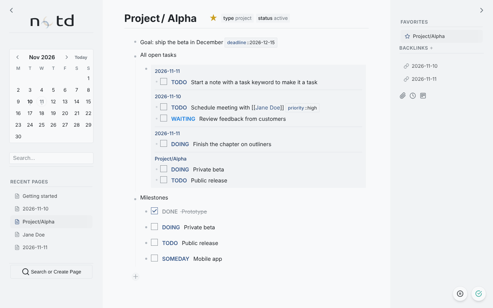
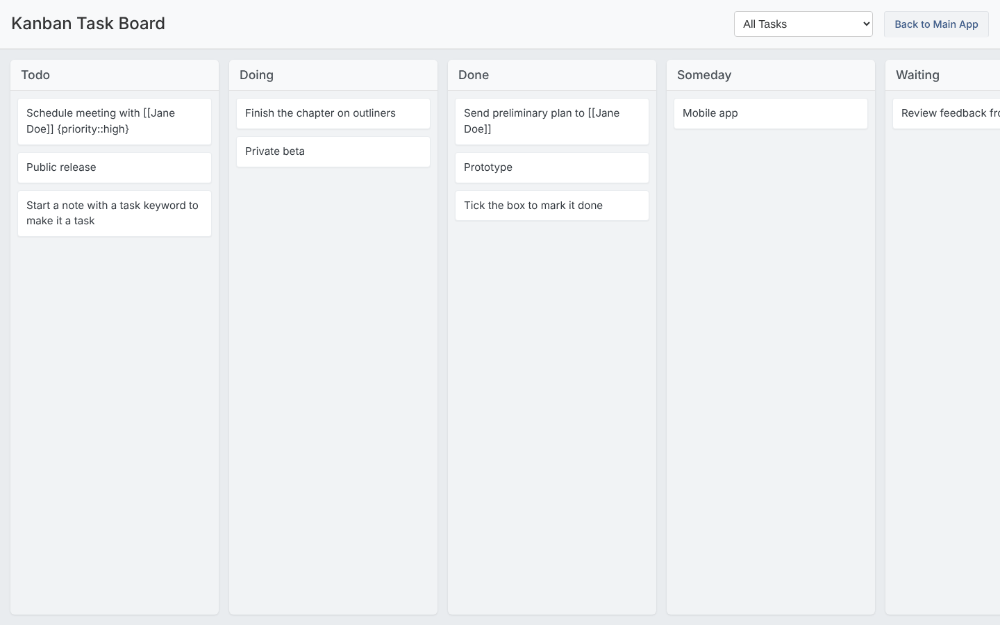

## Journal

notd opens on the page for today's date (for example `2026-11-10`). Journal pages are created the first time you open a date, so the journal is simply where you start writing each day.

Move between days with:

- the calendar in the left sidebar (days with a page are marked; **Today** jumps back),
- `Ctrl + Alt + Left` / `Ctrl + Alt + Right` for the previous and next day,
- a link such as `[[2026-11-14]]`.

## Tasks



A note that starts with one of these keywords is a task:

| Keyword | Meaning |
|---|---|
| `TODO` | To be done |
| `DOING` | In progress |
| `DONE` | Completed |
| `SOMEDAY` | Not now |
| `WAITING` | Blocked on something else |
| `CANCELLED` | Will not be done |

```markdown
TODO Review project proposal
DOING Write documentation {assigned::john}
WAITING Client approval for design
```

Each task must be its own note. Tick the checkbox to mark a task `DONE`; untick it to return it to `TODO`. For other states, edit the keyword.

<div class="message focus" data-component="message">
Every change of state is recorded as a <code>status</code> log property on the note, and completing a task records <code>done_at</code>. The history stays even when the keyword changes again.
</div>

The list of keywords is the `TASK_STATES` setting. The interface also understands `NLR` (no longer required); add it to `TASK_STATES` if you want it indexed and shown on the kanban board.

### Organising tasks



Add properties to tasks and use them to slice your work:

```markdown
TODO Research new tools {priority::high} {project::alpha} {due::2026-11-25}
```

- **Search** for a keyword or a property (`priority::high`) to find tasks anywhere.
- **Query** them into any page. All open tasks of one project:

  ```markdown
  SQL{SELECT DISTINCT N.id FROM Notes N JOIN Properties P ON N.id = P.note_id WHERE P.name = 'project' AND P.value = 'alpha' AND N.content LIKE 'TODO %'}
  ```

- **Kanban board.** The [kanban extension]() shows all tasks in columns by state; dragging a card changes the task's keyword.


