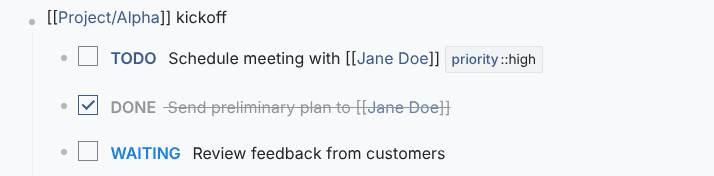
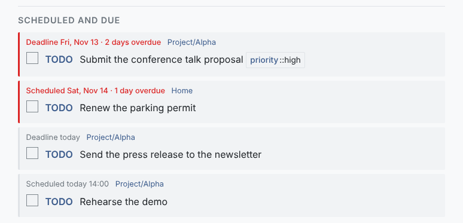
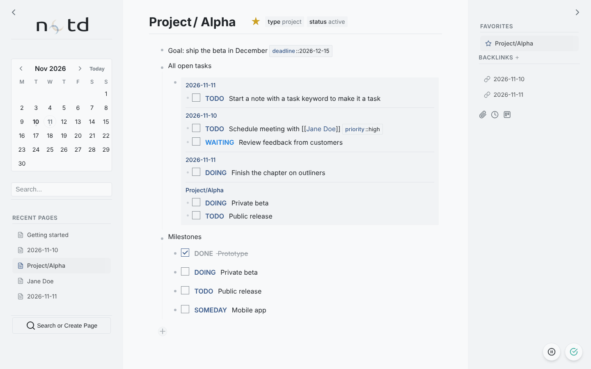
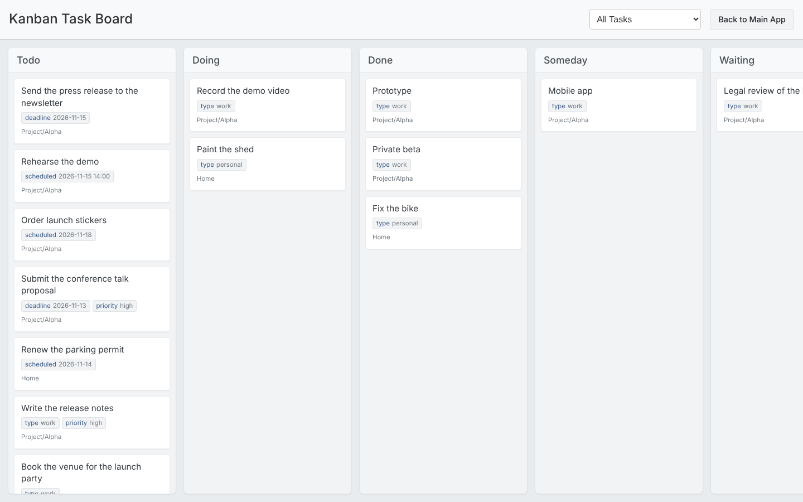

## Journal

notd opens on the page for today's date (for example `2026-11-10`). Journal pages are created the first time you open a date, so the journal is simply where you start writing each day.

Move between days with:

- the calendar in the left sidebar (days with a page are marked; **Today** jumps back),
- `Ctrl + Alt + Left` / `Ctrl + Alt + Right` for the previous and next day,
- a link such as `[[2026-11-14]]`.

## Tasks



A note that starts with one of these keywords is a task:

| Keyword | Meaning |
|---|---|
| `TODO` | To be done |
| `DOING` | In progress |
| `DONE` | Completed |
| `SOMEDAY` | Not now |
| `WAITING` | Blocked on something else |
| `CANCELLED` | Will not be done |

```markdown
TODO Review project proposal
DOING Write documentation {assigned::john}
WAITING Client approval for design
```

Each task must be its own note. Tick the checkbox to mark a task `DONE`; untick it to return it to `TODO` (`Ctrl + Z` undoes either). For other states, edit the keyword.

<div class="message focus" data-component="message">
A task's <code>status</code> property is always its current keyword, so searches and queries see the task as it is now. The first time a task is marked done, <code>done_at</code> records when.
</div>

The list of keywords is the `TASK_STATES` setting.

### Scheduled and due

Give a note a date with `{scheduled::2026-11-16}` (when you plan to do it) or `{deadline::2026-11-20}` (when it must be done). A time can follow the date: `{scheduled::2026-11-16 14:00}`. Typing `:s` or `:u` followed by a space inserts either one with today's date, ready to change.

The journal page of that day lists the note under **Scheduled and due**, below the outline:



- **Today's page** also lists open tasks whose date has passed, marked as overdue, until they are done. Overdue tasks come first, then the day's deadlines, then what is scheduled.
- **Other days** list what is scheduled or due on that day.
- Tasks that are `DONE` or `CANCELLED` are left out. A note that is not a task is listed on its day only.
- Tick a checkbox to mark the task done where it lives; the item leaves the list. Click the page name to go to the note.
- Notes on the journal page itself are not repeated in the list.

A date in a property is a link: click `2026-11-16` in `{scheduled::2026-11-16}` to open that day.

### Organising tasks



Add properties to tasks and use them to slice your work:

```markdown
TODO Research new tools {priority::high} {project::alpha} {deadline::2026-11-25}
```

- **Search** for a keyword or a property (`priority::high`) to find tasks anywhere.
- **Query** them into any page. All open tasks of one project:

  ```markdown
  SQL{SELECT DISTINCT N.id FROM Notes N JOIN Properties P ON N.id = P.note_id WHERE P.name = 'project' AND P.value = 'alpha' AND N.content LIKE 'TODO %'}
  ```

- **Kanban board.** The [kanban extension]() shows all tasks in columns by state; dragging a card changes the task's keyword.


