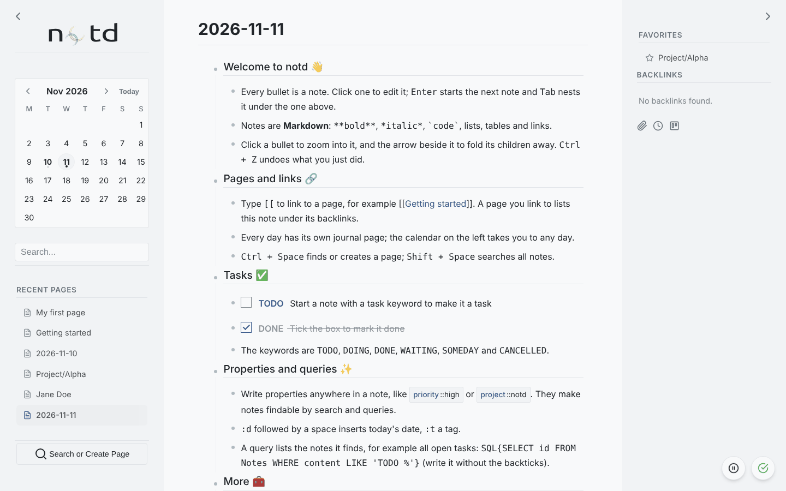

## Layout

| Area | Contents |
|---|---|
| Left sidebar | Calendar, search, recent pages, **Search or Create Page**, extensions |
| Centre | Page title, the ☆ favourite star and the gear (page name, text and properties, print, export, lock, delete), then the outline |
| Right sidebar | Favorites, backlinks, child pages |
| Bottom right | Save status |

Both sidebars can be collapsed with the arrows at the top. On a phone the sidebars are hidden and a toolbar at the bottom opens them and adds notes.

## The note menu

Right-click a bullet for actions on that note:

- **Zoom in**: show only this note and its children (a left click on the bullet does the same)
- **Add child note**
- **Copy link to note**: a URL that opens the page at this note
- **Copy embed code**: the `!{{...}}` text that embeds this note elsewhere
- **Upload attachment**
- **Open in Zen Writer / Excalidraw / Math Notepad**: when those extensions are active (not on locked pages)
- **Delete**: remove the note and its children (`Ctrl + Z` brings them back)

## Keyboard shortcuts

### Anywhere

| Shortcut | Action |
|---|---|
| `Ctrl + K` | Go to the search field |
| `Ctrl + Space` | Search or create a page |
| `Shift + Space` | Search notes (outside a note) |
| `Ctrl + B` | Show backlinks |
| `Ctrl + Alt + Left / Right` | Previous / next day (on a journal page) |
| `Ctrl + Z` / `Ctrl + Shift + Z` | Undo / redo outline changes |
| `Escape` | Close a window |

### In a note

| Shortcut | Action |
|---|---|
| `Enter` | Split the note at the caret (at the end: a new note below; on a parent that is open: a new first child; on an empty last child: move it out a level) |
| `Shift + Enter` | Line break |
| `Ctrl/Cmd + Enter` | New child note |
| `Tab` / `Shift + Tab` | Indent / outdent |
| `Up` / `Down` | Previous / next note, from the first / last line |
| `Ctrl/Cmd + Up / Down` or `Alt + Shift + Up / Down` | Move the note up / down among its siblings |
| `Backspace` at the start | Join the note with the one above |
| `Ctrl/Cmd + Z`, `Ctrl/Cmd + Shift + Z` | Undo / redo (typing first, then outline changes) |
| `Alt + Right` / `Alt + Left` | Zoom into the note / back out |
| `Escape` | Stop editing |
| `/` | Insert a template |
| `[[` | Suggest pages to link |
| `:t` `:k` `:d` `:r` + space | Insert `{tag::}`, `{keyword::}`, today's date, the current time |

## Themes

Set `ACTIVE_THEME` in `config.local.php` to one of `default`, `darkly`, `flatly`, `purple` or `ubuntu`. A theme is a single CSS file of custom properties in `assets/css/themes/`; copy one to make your own.
